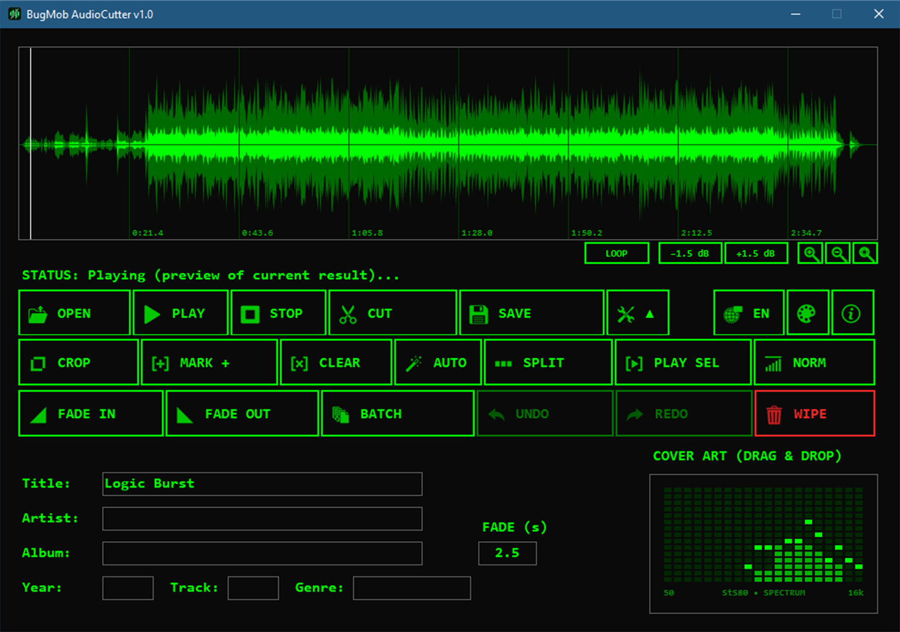
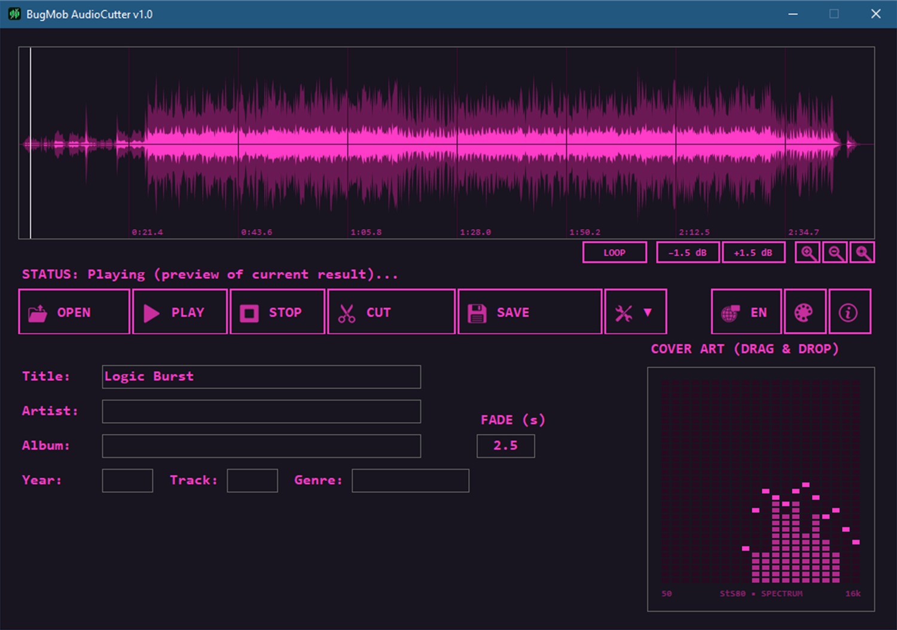

# BugMob AudioCutter

Cut, split and tag **MP3, FLAC, M4A and WAV** files without re-encoding, so the audio keeps its original quality. Portable and free: one small file, no installer.





## Download

Get the latest version from the **[Releases page](../../releases/latest)**: `BugMob_AudioCutter.exe`.

- Windows 10 / 11
- .NET Framework 4.8 (already part of Windows 10 / 11)
- A single file, about 454 KB. No installation.

Prefer an installer-style experience with automatic updates? It is also available from the [Microsoft Store](https://apps.microsoft.com/detail/9NQN898DQ2HZ).

## What it does

**Cut without losing quality**
- Mark a part of the waveform with the mouse, then CUT it out or CROP to keep only that part. Mark several parts at once with MARK +.
- Original quality is kept: the audio is not re-encoded.

**Split**
- SPLIT saves every marked part as its own file.
- AUTO finds silences for you, or splits a long recording into equal parts every N minutes (albums, mixes, lectures, audiobooks).

**Fade and volume** (MP3 and WAV)
- Fade at every cut, Fade In, Fade Out, normalization (NORM) and +/-1.5 dB volume steps.

**Tags and cover art** (MP3, FLAC, M4A, WAV)
- Title, artist, album, year, track, genre and cover picture (drag and drop). One click removes all tags and cover art (WIPE).

**Everything else**
- BATCH: remove silence, normalize and fade many files at once. Your originals are not touched.
- Listen before you save: play from any point, preview only the marked part, loop, zoom the waveform. A retro spectrum analyzer moves while it plays.
- Undo / Redo.
- MP4 video as a source: cut only the audio, saved as .m4a.
- 8 languages: English, Serbian, Spanish, German, Russian, Portuguese, French, Italian.
- Retro themes: Terminal Green, Synthwave Night, Amber CRT, Dragon Red. There is a fifth one too, but you will have to find it yourself.

## Privacy

- Your audio files never leave your computer. There is no telemetry and no account.
- Once a week the program checks whether a new version exists (only the version number is sent). You can turn this off in About. The Microsoft Store version does not do this at all.
- Settings (language, theme) are saved in a small file, `BugMobAudioCutter.ini`, next to the program.

## Check your download

The SHA-256 of the program file is:

```
66cdfe5b7a4c4825aa70bb64765d51ce8323a0f0676a26b52a044655a3d0dd00
```

To check it in PowerShell:

```powershell
Get-FileHash .\BugMob_AudioCutter.exe -Algorithm SHA256
```

The same hash is on the release page and in the `.sha256` file. (The Microsoft Store version is a different package and has a different hash.)

## Windows may warn you

The program is not code-signed, so Windows SmartScreen may show a warning the first time. Choose "More info" and then "Run anyway". If you would rather not see a warning, use the Microsoft Store version.

## License

Free for personal and commercial use. The audio files you create belong to you.

The program is copyrighted by BugMob. All rights reserved. Copying, modifying, reverse engineering, rebranding, selling or redistributing the program requires written permission from the author. Provided "as is", without warranty. Full terms: [bugmob.com/uslovi](https://bugmob.com/uslovi).

The source code is not published.

## Links

- Website: [bugmob.com/audiocutter](https://bugmob.com/audiocutter?iz=github)
- Microsoft Store: [BugMob AudioCutter](https://apps.microsoft.com/detail/9NQN898DQ2HZ)

